# Andjelica Braids Studio — Sitio web

Estudio boutique especializado en trenzado profesional, peinados protectores y venta de insumos para el cuidado del cabello afro y natural en Valparaíso, Chile.  
Incluye **landing page**, **blog educativo** y **catálogo/tienda online**.

> 🎓 **Evaluación Parcial 02 — Sitios Web y Landing Pages (DUOC UC)**  
> 📌 **Entrega Fase 3:** Prototipo referencial en Google Stitch y Aseguramiento de Calidad (QA).  
> 🚀 **Acceso directo al documento de entrega:** [📁 docs/11-qa.md (QA, User Flows y Coherencia)](docs/11-qa.md)  
> 🎨 **Pwojè / Proyecto interactivo en Google Stitch:** [Ver en Google Stitch](https://stitch.withgoogle.com/projects/967158101842086540)  
> 📖 Pauta y enunciado: [evaluacion/README.md](evaluacion/README.md)

---

## 🎨 Fase 3 — Prototipo Referencial y QA

- **Proyecto interactivo en Google Stitch:** [https://stitch.withgoogle.com/projects/967158101842086540](https://stitch.withgoogle.com/projects/967158101842086540)
- **Documento completo de entrega:** [docs/11-qa.md](docs/11-qa.md) *(contiene la tabla de revisión Spec vs. Prototipo, mejoras aplicadas, recorrido de los 2 User Flows y reflexión de coherencia).*

### Vista previa de pantallas (Desktop y Mobile)

| Pantalla | Versión Desktop | Versión Mobile |
|---|---|---|
| **Landing Page** | 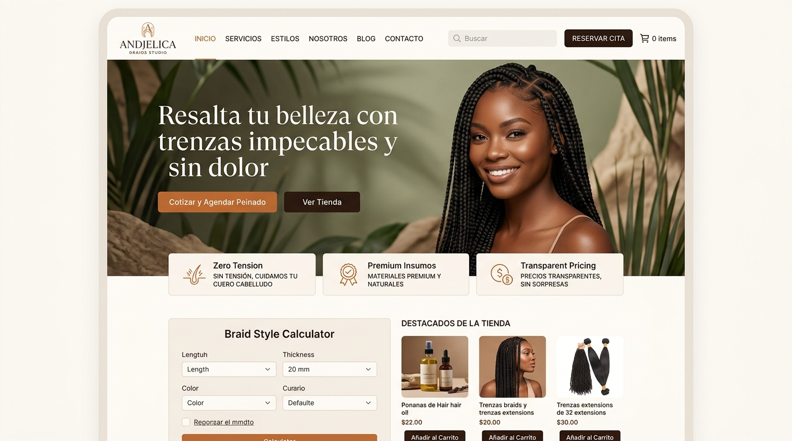 | 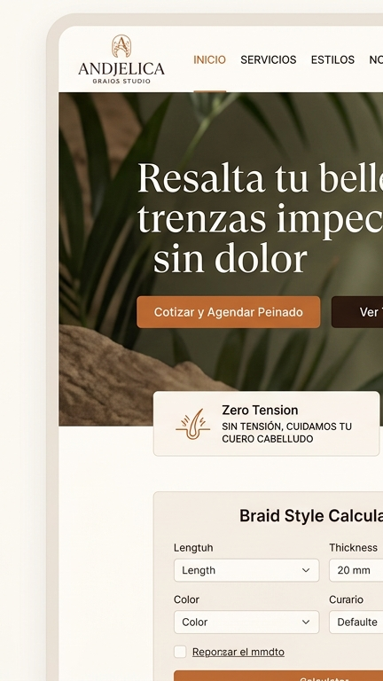 |
| **Tienda (Catálogo)** | 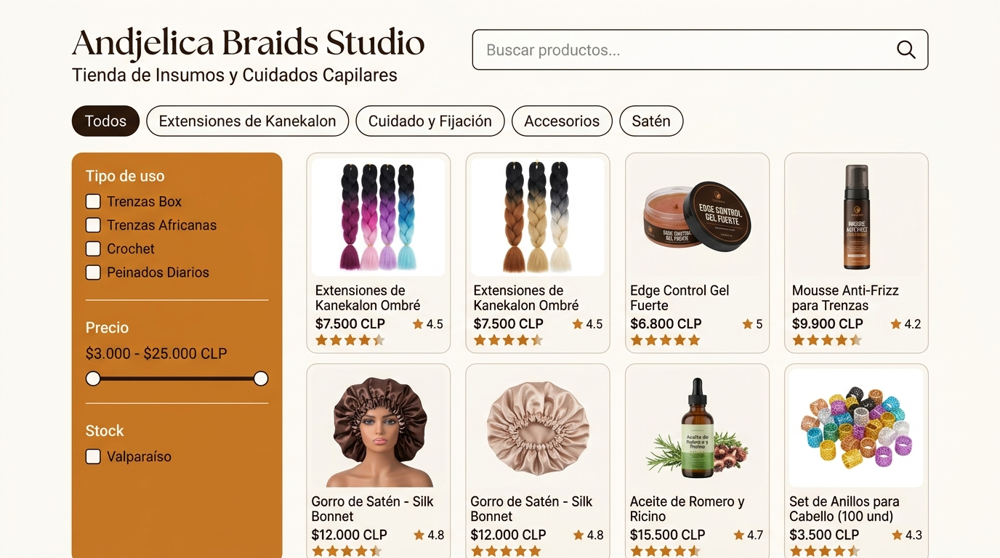 | 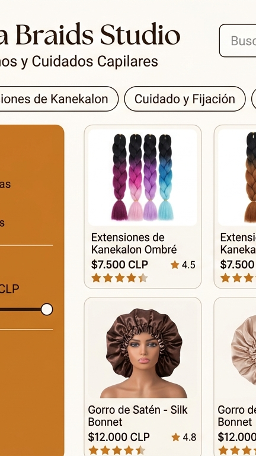 |
| **Ficha de Producto** | 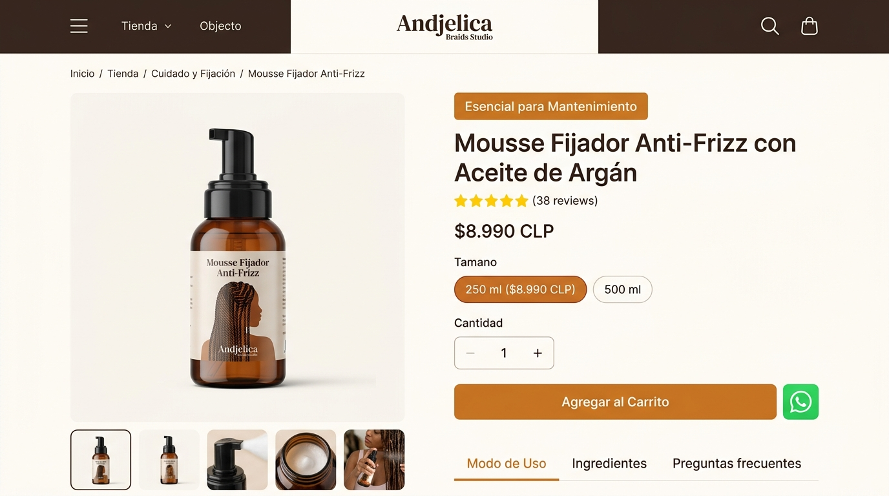 | 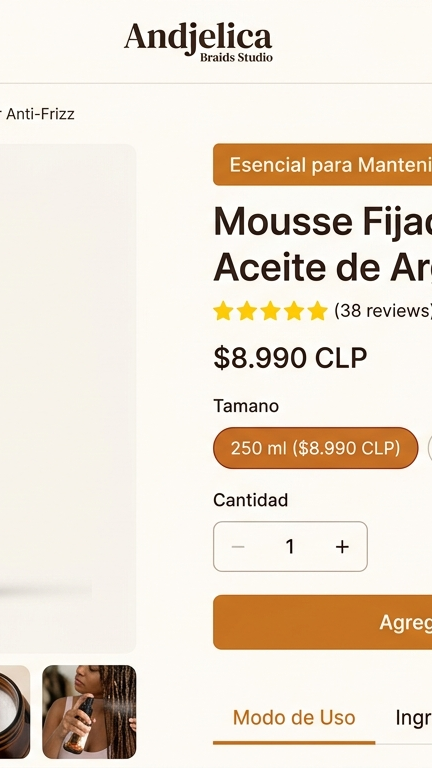 |
| **Carrito de Compras** | 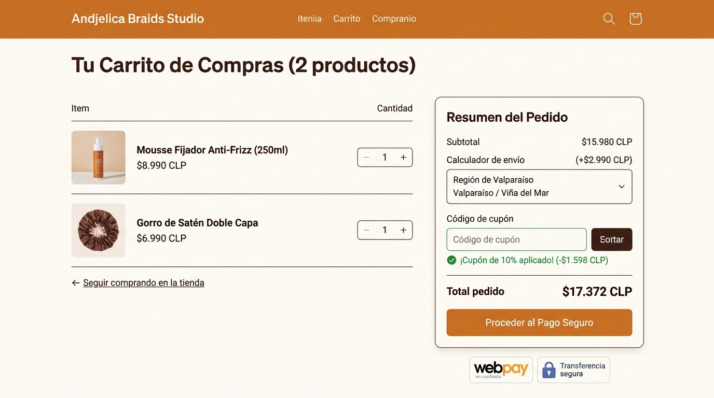 | 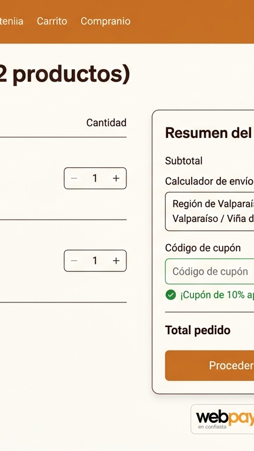 |
| **Blog Educativo** | 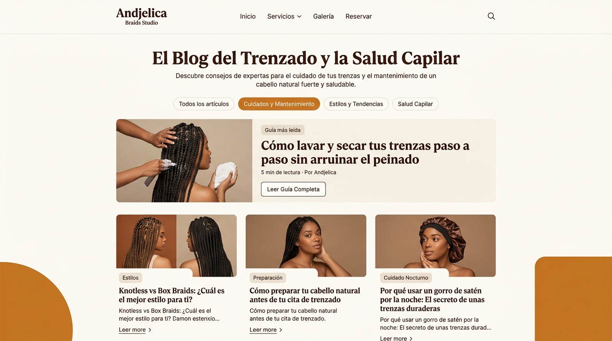 | 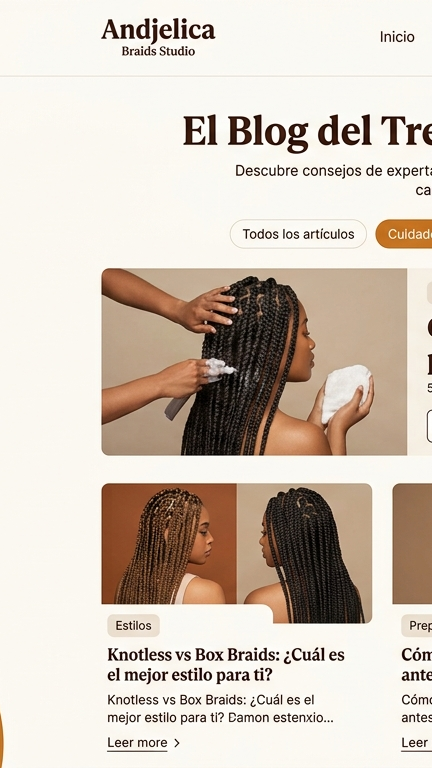 |
| **Artículo de Blog** | 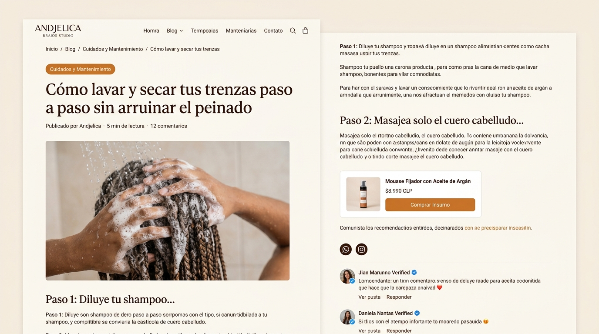 | 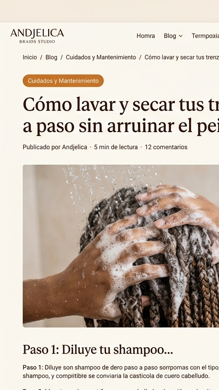 |

---

## 📚 Índice de Documentación Completa

### Fase 1 — Definición de requerimientos
- [01. Brief del emprendimiento](docs/01-brief.md)
- [02. Proto-persona principal](docs/02-proto-personas.md)
- [03. Objetivos y funcionalidades (base y propias)](docs/03-funcionalidades.md)
- [04. Tecnologías y restricciones](docs/04-tecnologias.md)
- [05. Arquitectura de información, user flows y categorías](docs/05-arquitectura.md)

### Fase 2 — Construcción de specs
- [Design system oficial (DESIGN.md)](DESIGN.md)
- [06. Moodboard y referencias](docs/06-moodboard.md)
- [07. Calco de componentes](docs/07-componentes.md)
- [08. Paleta cromática y tipografía](docs/08-color-tipografia.md)
- [09. Spec de diseño y prompts para Stitch](docs/09-spec-diseno.md)
- [10. Spec de desarrollo y arquitectura técnica](docs/10-spec-desarrollo.md)

### Fase 3 — Prototipo referencial y QA
- [11. Prototipo, QA, User Flows y Coherencia](docs/11-qa.md)

---

## Uso de IA

- **Antigravity AI (Gemini 3.7 Flash):** Utilizado de manera integral a lo largo de las tres fases del proyecto:
  1. **Fase 1 (Requerimientos):** Estructuración y redacción del Brief, Proto-persona (Valeria Méndez), Objetivos y Funcionalidades (base y propias), Stack de Tecnologías y Arquitectura de la Información (Sitemap, User Flows y Categorías).
  2. **Fase 2 (Specs):** Construcción del Moodboard, Calco de Componentes, Paleta cromática con validación WCAG AA, Tipografía, el Design System oficial en `DESIGN.md` (validado con `@google/design.md`), Spec de Diseño con prompts detallados por pantalla y Spec de Desarrollo con arquitectura técnica y criterios de aceptación.
  3. **Fase 3 (Prototipo y QA):** Generación de prompts para Google Stitch, revisión comparativa de Spec vs. Prototipo, documentación de brechas y correcciones iterativas en `docs/11-qa.md`, validación de recorridos de User Flows y redacción de la reflexión de coherencia respecto al brief y las necesidades de la usuaria.
